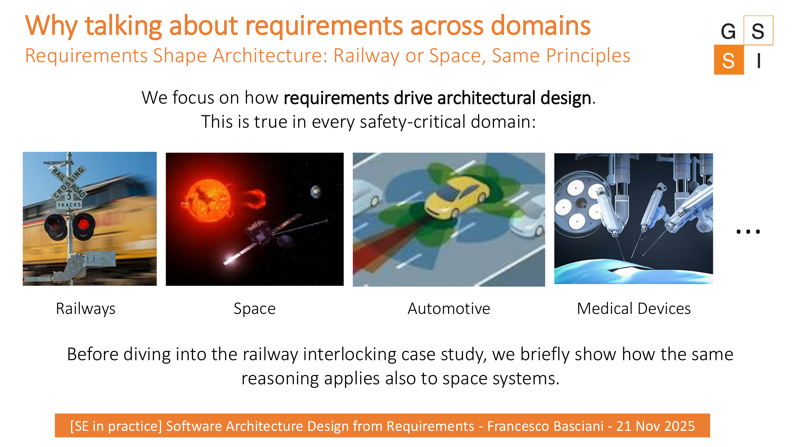
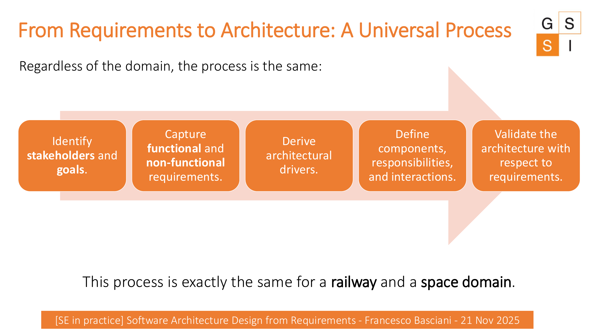

# Requirements Shape Architecture

Software architecture does not start from boxes and arrows. It starts from **what the system is expected to achieve** and from the constraints under which it must operate.

The same reasoning applies across safety-critical domains such as railways, space, automotive systems, and medical devices.

## A reusable process

The lecture uses the following sequence:

::::{grid} 1 1 5 5
:::{card} 1 · Identify
**Stakeholders and goals**
:::
:::{card} 2 · Capture
**Functional and non-functional requirements**
:::
:::{card} 3 · Derive
**Architectural drivers**
:::
:::{card} 4 · Define
**Components, responsibilities, interactions**
:::
:::{card} 5 · Validate
**Architecture against requirements**
:::
::::

:::{important} Core idea
A requirement matters architecturally when it influences important structural or behavioral decisions: component boundaries, communication, responsibilities, isolation, timing, integration, or other system-wide choices.
:::

## Before we look at the case study

Think about the following question:

> If two systems belong to completely different domains, can the reasoning process from requirements to architecture still be the same?

:::{dropdown} Discussion prompt
:class: hint
Ask students for one example of a requirement from any domain and one architectural decision that could plausibly follow from it. The goal is not to obtain a unique answer, but to make the requirements-to-design connection explicit.
:::
