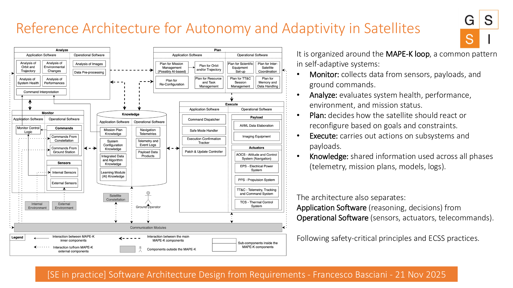

# A Cross-Domain Example: Satellites

Before moving to railways, consider how the same requirements-to-architecture reasoning appears in a space system.

## Requirements

A satellite may need to:

- operate autonomously when no contact with ground is available;
- guarantee safety and recovery under faults;
- react to environmental changes such as orbit, temperature, and radiation;
- process data under strict timing constraints;
- isolate critical components in separate partitions.

## Architectural needs

From these requirements, the lecture derives needs such as:

- monitoring modules;
- adaptive decision logic;
- communication layers;
- partitioned execution environments.

:::{note} What to notice
The point is not the satellite domain itself. The point is the **reasoning step**: a requirement creates pressure on the architecture, and that pressure becomes a design need.
:::

## Reference architecture for autonomy and adaptivity

The reference architecture is organized around the **MAPE-K loop**:

::::{tab-set}
:::{tab-item} Monitor
Collects information from sensors, payloads, and ground commands.
:::
:::{tab-item} Analyze
Evaluates system health, performance, environment, and mission status.
:::
:::{tab-item} Plan
Decides how the satellite should react or reconfigure according to goals and constraints.
:::
:::{tab-item} Execute
Carries out actions on subsystems and payloads.
:::
:::{tab-item} Knowledge
Provides shared information such as telemetry, mission plans, models, and logs.
:::
::::

The architecture also separates **Application Software** (reasoning and decisions) from **Operational Software** (sensors, actuators, telecommands).

:::{dropdown} Instructor takeaway
:class: tip
Use this example briefly. Its role is to establish that autonomy, safety, isolation, and timing are not merely statements in a requirement document: they influence architectural organization.
:::

## Transition to the railway case

The engineering mindset remains the same:

- requirements determine **what** the system must do;
- architectural design determines **how** it will do it;
- the reasoning applies across critical domains.
