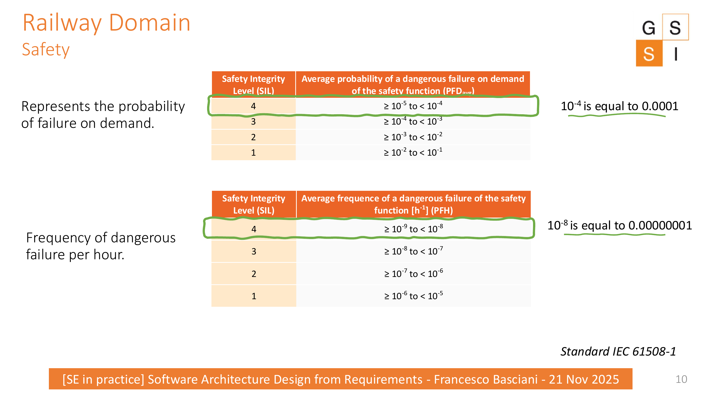
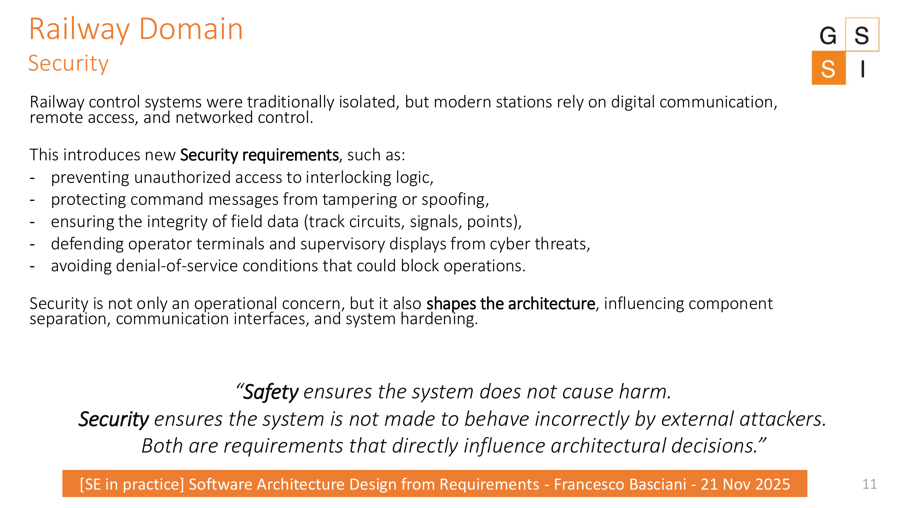
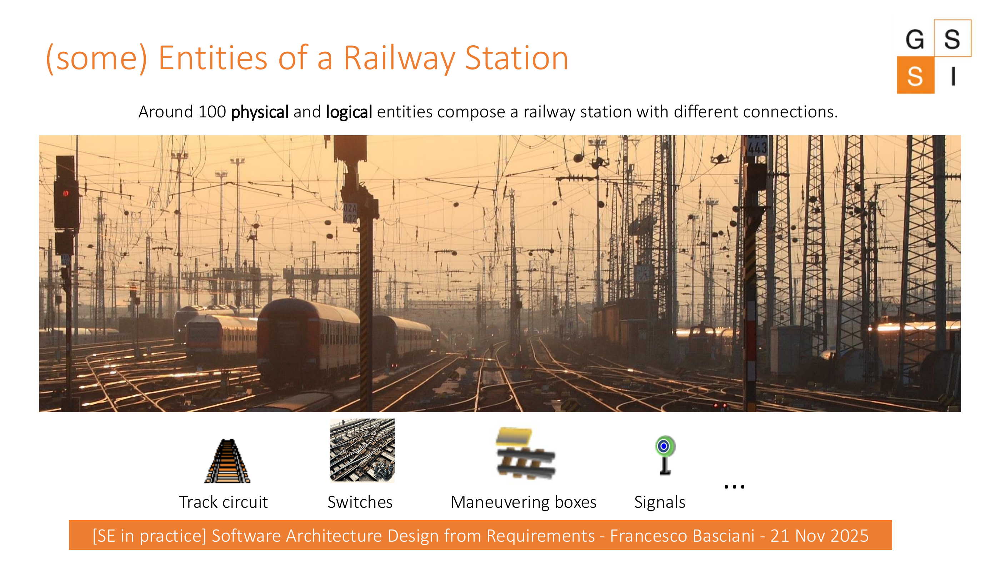

# Entering the Railway Domain

Before designing the Train Station Simulator, the lecture introduces four concerns that characterize the railway context: **safety, security, reliability, and efficiency**.

## Safety

Railway systems operate under stringent safety expectations. The lecture introduces **Safety Integrity Levels (SIL)** through probability of dangerous failure on demand and frequency of dangerous failure per hour.

:::{important} What students should retain
The numerical thresholds do not need to be memorized. The relevant architectural lesson is that demanding safety requirements affect how components are separated, validated, and monitored.
:::

## Security

Modern railway control systems rely on digital communication, remote access, and networked control. This introduces requirements such as:

- preventing unauthorized access to interlocking logic;
- protecting command messages from tampering or spoofing;
- ensuring integrity of field data;
- defending operator terminals and supervisory displays;
- avoiding denial-of-service conditions that could block operations.

:::{note}
**Safety** concerns avoiding harmful system behavior.  
**Security** concerns preventing external actors from making the system behave incorrectly.  
Both influence architectural decisions.
:::

## Reliability

Reliable railway systems are expected to support smooth and predictable operation, minimizing disruptions that can affect passengers, goods, and the wider network.

## Efficiency

Railways must move people and goods effectively, reduce delays and costs, and use resources efficiently. Planning, optimized routes, and supporting technologies contribute to this goal.

## A station is not a single object

A railway station is composed of many physical and logical entities and their connections. Examples in the lecture include:

- track circuits;
- switches;
- maneuvering boxes;
- signals.

:::{dropdown} Pause for discussion
:class: hint
If a simulator has to reproduce a railway station, which of these domain concerns will become **functional requirements**, and which will become **non-functional requirements** or architectural constraints?
:::
