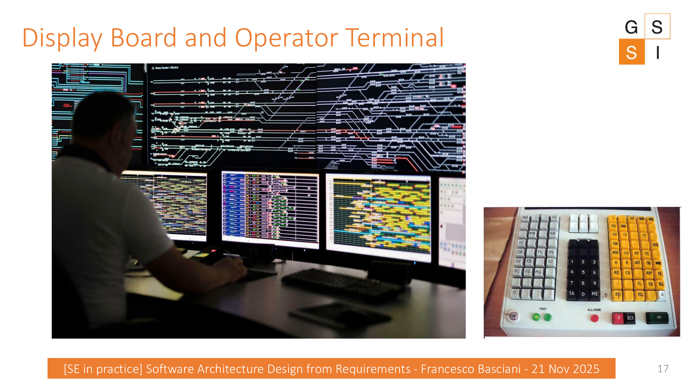

# The Train Station Simulator

This is the problem statement used for the group exercise.

:::{important} Read this section as a specification seed
Do not jump immediately to components. First identify **goals, actors, behaviors, constraints, and information flows**.
:::

## Context

The Train Station Simulator supports operational efficiency and safety in railway management. It emulates a railway station environment so that operators can experiment, test emergency responses, and refine command strategies without real-life risks.

The simulated environment includes:

- track layouts;
- signaling systems;
- train behaviors.

## Main system parts

The system has two main parts:

::::{grid} 1 1 2 2
:::{card} Station Simulator
Simulates railway field entities such as tracks, signals, and switches. It also includes a **Train Simulator** that reads the field status and can interact with and modify the state of field entities.
:::
:::{card} Central Control Unit
Includes **Safety Logic**, **Operator Terminal**, and **Display Board**. It supports safe control, operator commands, and observation of station status.
:::
::::

## Communication constraint

Communication between the two parts is continuous and rapid:

> Commands from the Central Control Unit and current station controls from the simulator are exchanged every **300 milliseconds**.

:::{warning} Architectural significance
The 300 ms interval is not just descriptive text. It is a concrete requirement that must be considered when designing communication and responsiveness.
:::

## Responsibilities

### Central Control

- **Safety Logic** ensures compliance with safety regulations.
- **Operator Terminal** translates human intent into digital directives.
- **Display Board** presents a comprehensive view of operational status.
- The Central Control operator manages the station and observes operations through the Display Board.

### Station Simulator

- simulates tracks, signals, switches, and other field entities;
- contains the Train Simulator;
- allows the Train Simulator to read and modify field state;
- allows the Station Simulator operator to issue commands to train and field-entity simulators.

## Future integration

The Station Simulator is designed to be **detached from the Central Control**, allowing future integration with real-world stations.

:::{important} Design clue
This requirement has direct implications for coupling and interfaces between the two main parts of the system.
:::

## Existing operator views

The original lecture shows examples of a **Display Board** and an **Operator Terminal** to make the operational context concrete.

:::{dropdown} Requirements spotting exercise
:class: hint
Before moving on, ask the class to identify at least:

1. one functional requirement;
2. one performance-related requirement;
3. one safety-related requirement;
4. one integration/evolution requirement.

Do not reveal a complete list yet.
:::
