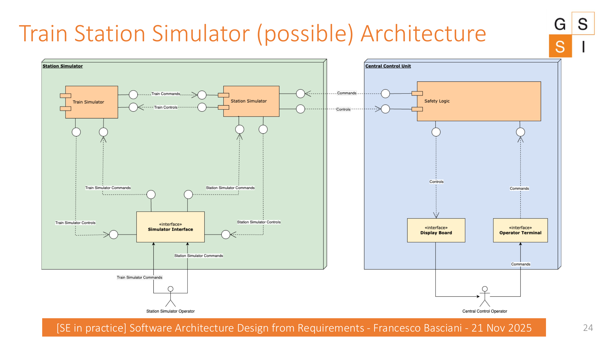

# Debrief and a Possible Solution

This section is intended for the **collective discussion after the group activity**. It is not presented as the only correct solution.

:::{warning} Instructor use
When projecting the book, keep the dropdowns below closed until groups have presented their work.
:::

## Possible functional requirements

:::{dropdown} Reveal functional requirements
:class: important
| Requirement | Description |
|---|---|
| Simulate Railway Station Environment | Emulate the dynamic environment of a real-world railway station, including track layouts, signaling systems, and train behaviors. |
| Scenario Exploration and Testing | Allow operators to experiment with scenarios, test emergency responses, and refine command strategies in a risk-free virtual environment. |
| Continuous Communication with Central Control | Maintain continuous and rapid communication with Central Control, exchanging command and control messages every 300 milliseconds. |
| Safety Logic Compliance | Ensure operations comply with strict safety regulations. |
| Translate Human Commands into Digital Directives | Allow the Operator Terminal to translate human intent into digital commands. |
| Real-Time Operational Status Display | Present a comprehensive and real-time view of station operational status. |
| Simulation of Field Entities | Simulate field entities such as tracks, signals, and switches. |
| Dynamic Interaction by Train Simulator | Allow the Train Simulator to interact with and alter the state of field entities. |
| Command Issuance by Station Simulator Operator | Allow the Station Simulator operator to issue commands to train and field-entity simulators. |
| Station Management and Observation by Central Control Operator | Allow the Central Control operator to manage the station and observe operations through the Display Board. |
:::

## Possible non-functional requirements

:::{dropdown} Reveal non-functional requirements
:class: important
| Requirement | Description |
|---|---|
| High System Responsiveness | Maintain high responsiveness, especially the 300 ms message-exchange interval. |
| Reliability and Accuracy | Provide reliable and accurate simulations of railway station operations and scenarios. |
| User-Friendly Interface for Operators | Make Station Simulator and Central Control interfaces intuitive and user-friendly. |
| Scalability and Integration with Real-world Stations | Support a scalable architecture and allow the Station Simulator to be detached from Central Control for integration with real-world stations. |
| Safety and Emergency Response Training Capability | Support effective training for safety procedures and emergency response strategies. |
| Real-Time Data Processing and Visualization | Process and visualize data in real time to reflect the current simulated state. |
| Flexibility in Scenario Customization | Allow customization of operational scenarios for training and testing. |
| Maintainability and Upgradability | Support future enhancements and technological evolution. |
:::

## From requirements to architectural decisions

Use the table below to drive the debrief. Ask groups whether their design provides an explicit response to each driver.

| Requirement / driver | Architectural question |
|---|---|
| 300 ms communication | Where is the communication boundary? How is rapid exchange represented? |
| Safety Logic | Is safety responsibility explicit and separated from operator interaction? |
| Real-time status | Which component owns visualization of current station state? |
| Train-field interaction | Which component owns train behavior and who owns field entities? |
| Detachable Central Control | Is the interface between the two main subsystems explicit enough to support replacement/integration? |
| Maintainability / evolution | Which responsibilities can evolve independently? |

## A possible abstract architecture

:::{dropdown} Reveal the architecture proposed in the original lecture
:class: tip
The original lecture proposes an architecture with a **Station Simulator** side and a **Central Control Unit** side. The diagram includes the Train Simulator, Station Simulator, a simulator-facing interface, Safety Logic, Display Board, and Operator Terminal, with communication between the two main subsystems.

:::

## Architecture validation discussion

A proposed architecture should be examined against the requirements rather than accepted because the diagram looks plausible.

::::{grid} 1 1 2 2
:::{card} Traceability
Can each major component or interaction be justified by one or more requirements?
:::
:::{card} Coverage
Are important requirements missing from the architecture?
:::
:::{card} Separation of responsibilities
Are safety, operator interaction, simulation, and visualization responsibilities sufficiently clear?
:::
:::{card} Future integration
Can the Station Simulator remain useful if Central Control is detached or replaced?
:::
::::

:::{important} Final takeaway
The goal of architectural design is not to produce a diagram first and rationalize it later. Start from goals and requirements, derive the architectural drivers, make explicit design decisions, and then validate those decisions against the original requirements.
:::

## Closing question

> Which requirement changed your architecture the most, and why?
